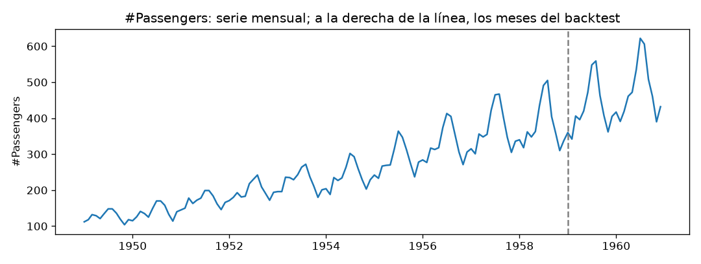

# Informe del miniproyecto 2

Llene cada sección reemplazando los marcadores `{{...}}`, sin quitar las
secciones. Las cifras salen de lo que imprime `python miniproyecto.py` y las
figuras son las que ese guion deja en `figuras/`. Las fórmulas van en LaTeX
(`$...$` o `$$...$$`).

## 1. La serie y el modelo a superar

{{La serie en dos o tres líneas: qué mide, periodo, número de observaciones
y la decisión sobre huecos y datos atípicos que se trae del miniproyecto 1.}}

{{El mejor modelo del miniproyecto 1, escrito con su ecuación, y sus
métricas en este *backtest*. Si no coinciden con las del miniproyecto 1,
qué cambió y por qué.}}

## 2. La tabla supervisada

{{Las columnas de la tabla: qué rezagos, qué variables de fecha y qué
estadísticas de ventana móvil, con la fórmula de cada una. Qué aprenden los
modelos (`OBJETIVO`: la serie o su diferencia con el mismo mes del año
anterior) y por qué.}}

{{Cómo prueba el guion que ninguna fila ve el mes que predice, y qué
imprime.}}

{{Cómo funciona el pronóstico recursivo a 12 meses y dónde se ajusta el
escalador dentro de cada origen del *backtest*.}}

## 3. Aprendizaje automático

{{La rejilla de cada modelo, con qué datos y con qué validación temporal se
eligió, y los hiperparámetros elegidos con su RMSE de validación. Por qué
ninguno de los meses del *backtest* participa en la elección.}}

{{Qué variables pesan más en Random Forest y en XGBoost, y si coinciden con
los rezagos que marcaba la PACF en el miniproyecto 1.}}

{{RMSE, MAE y MAPE de los cuatro modelos y cuál gana entre ellos.}}

## 4. Aprendizaje profundo

{{Las tres redes: arquitectura, número de parámetros y cómo recibe cada una
la entrada (columnas sueltas o secuencia). Cuál es la tercera red y por qué
la eligió el grupo.}}

{{Lectura de las curvas: dónde empieza el sobreajuste, cuántas épocas se
eligieron para cada red y qué tamaño de MLP quedó.}}

{{La mejor red con cinco semillas: el RMSE de cada una, la media y la
desviación. Si la diferencia con el clásico es mayor o menor que esa
desviación.}}

## 5. La tabla y la elección

{{Copie aquí `resultados/metricas.csv` como tabla de Markdown, ordenada por
RMSE.}}

| Modelo | RMSE | MAE | MAPE (%) | Parámetros | Segundos |
|---|---|---|---|---|---|
| {{...}} | {{...}} | {{...}} | {{...}} | {{...}} | {{...}} |

{{Si alguna red no supera al clásico, a qué lo atribuye el grupo y qué dato
de la serie lo muestra: el número de meses frente al número de parámetros,
el mes en que falla, la curva de pérdida o la variación entre semillas.}}

## 6. Conclusión

{{El modelo que el grupo pondría en uso y lo que se paga por él frente al
clásico: cuántos datos necesita, cuánto tarda en el *backtest* y qué tanto
se puede explicar su pronóstico.}}
