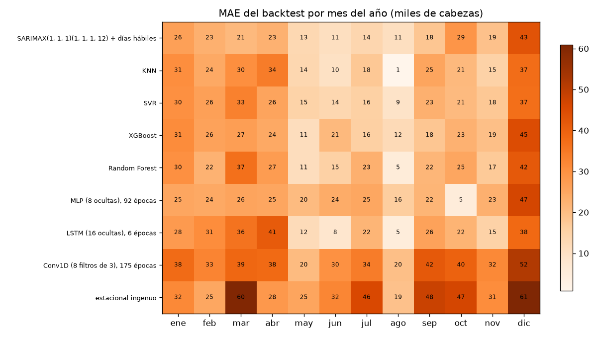

# Informe del miniproyecto 2

**Aprendizaje automático y profundo contra el mejor modelo clásico**

Osvaldo Emilio Marín Mora · código 94266189 · trabajo individual

Todas las cifras de este informe salen de `python miniproyecto.py`, y las
figuras son las que el guion deja en `figuras/`. Las métricas son
deterministas: semillas fijas en `numpy`, `scikit-learn`, `xgboost` y
`torch`, y `torch` con un solo hilo. Solo la columna `segundos` cambia un
poco de una corrida a otra; aquí van los de mi última corrida local, que
tomó 58 s en total (el límite de la acción de GitHub es 10 minutos).

## 1. La serie y el modelo a superar

La serie es la del miniproyecto 1: las **cabezas de ganado porcino
sacrificadas por mes en Colombia**, total nacional (DANE, Encuesta de
Sacrificio de Ganado), de **2008-10 a 2026-06, 213 meses**, sin meses
vacíos. La ficha está en `datos/README.md`. `preparar` es la misma: los dos
choques de un solo mes con causa conocida se reemplazan por
tendencia + estacional de la STL robusta, y el resto de la serie queda igual.

| Mes | Causa | Dato original | Valor que entra |
|---|---|---|---|
| 2020-04 | cuarentena nacional por el COVID-19 | 321 055 | 399 077 |
| 2021-05 | paro nacional | 390 325 | 447 915 |

Los dos quedan antes del primer origen del *backtest* (2024-06), que va de
2024-06 a 2025-06 (13 orígenes, horizonte de 1 a 12, prueba de 2024-07 a
2026-06).

**El modelo a superar** es el mejor de la tabla del miniproyecto 1: un
SARIMAX$(1,1,1)(1,1,1)_{12}$ ajustado en miles de cabezas, con los **días
hábiles del mes** ($x_t$: lunes a viernes que no son festivo) como exógena.
Es una regresión con errores SARIMA:

$$y_t = \beta\,x_t + \eta_t,\qquad
(1-\phi_1 B)(1-\Phi_1 B^{12})(1-B)(1-B^{12})\,\eta_t = (1+\theta_1 B)(1+\Theta_1 B^{12})\,\varepsilon_t ,$$

con $B$ el operador de rezago y $\varepsilon_t$ ruido blanco de varianza
$\sigma^2$. En el último origen (2025-06) el guion estima $\hat\beta = 7{,}881$
miles, es decir, **7 881 cabezas más por cada día hábil**,
$\hat\phi_1=-0{,}230$, $\hat\theta_1=-0{,}414$, $\hat\Phi_1=0{,}108$,
$\hat\Theta_1=-0{,}768$ y $\hat\sigma^2=111{,}55$ (miles²): **6 parámetros**.

**Sus métricas coinciden exactamente con las del miniproyecto 1:**

| | RMSE | MAE | MAPE (%) |
|---|---|---|---|
| Miniproyecto 1 | 25 279,41 | 20 848,26 | 3,60 |
| Este *backtest* | 25 279,41 | 20 848,26 | 3,60 |
| Estacional ingenuo (piso) | 43 141,26 | 37 837,01 | 6,64 |

Al trasladarlo **cambié una sola cosa**, y no cambia ninguna cifra: en el
miniproyecto 1 los festivos salían del paquete `holidays`, que no está en la
lista de bibliotecas permitidas de este miniproyecto. Ahora el guion calcula
el calendario de Colombia con la ley (`festivos`): seis festivos fijos, siete
que la Ley 51 de 1983 (Ley Emiliani) corre al lunes siguiente, los cinco que
dependen de la Pascua (jueves y viernes santo; Ascensión, Corpus Christi y
Sagrado Corazón, trasladados) y, desde 2026, el 9 de julio (Virgen de
Chiquinquirá). Lo comprobé contra `holidays` año por año de 2000 a 2030 y
coinciden todos los días, así que los días hábiles son los mismos y el
SARIMAX da las mismas métricas al centavo.

## 2. La tabla supervisada

**Qué aprenden los modelos.** Elegí `OBJETIVO = "dif12"`: los modelos
aprenden la diferencia con el mismo mes del año anterior,

$$z_t = y_t - y_{t-12},$$

y el pronóstico vuelve al nivel con $\hat y_t = y_{t-12} + \hat z_t$. El
guion imprime el dato que decide:

- En **nivel**, el máximo antes del *backtest* es 585 965 (2023-12), y **6
  de los 24 meses del *backtest* lo superan**. Un árbol pronostica promedios
  de sus hojas, así que nunca da un valor mayor que el máximo que vio: con
  una serie que se triplica entre 2008 y 2026 queda condenado a quedarse
  corto.
- En **diferencia anual**, el rango antes del *backtest* es
  $[-33\,225;\ 92\,674]$ y **22 de los 24 meses del *backtest* quedan
  dentro**.
- El guion lo mide: el mismo Random Forest por defecto da **RMSE 38 351
  aprendiendo el nivel y 27 691 aprendiendo la diferencia** (−28 %).

Es además la misma decisión del SARIMA, que tiene $D=1$: la diferencia
estacional quita la tendencia y casi toda la estacionalidad, y lo que queda
es el crecimiento interanual.

**Las 20 columnas de la fila del mes $t$.** Todas miran hacia atrás o al
calendario:

| Columnas | Fórmula | Qué aporta |
|---|---|---|
| `rezago_1` … `rezago_12` | $z_{t-k},\ k=1,\dots,12$ | la memoria del crecimiento interanual |
| `mes` | $m_t \in \{1,\dots,12\}$ | el mes del año, para los árboles |
| `mes_sen`, `mes_cos` | $\sin(2\pi m_t/12),\ \cos(2\pi m_t/12)$ | el mes en el círculo: diciembre queda junto a enero, para KNN, SVR y el MLP |
| `habiles` | $x_t$ | los días hábiles del mes |
| `dif_habiles` | $x_t - x_{t-12}$ | cuántos días hábiles gana o pierde el mes frente al mismo mes del año anterior: la parte de $z_t$ que explica el calendario |
| `media_3` | $\bar z^{(3)}_t = \tfrac13\sum_{j=1}^{3} z_{t-j}$ | el crecimiento reciente |
| `media_12` | $\bar z^{(12)}_t = \tfrac1{12}\sum_{j=1}^{12} z_{t-j}$ | el crecimiento del último año |
| `desv_12` | $s^{(12)}_t = \sqrt{\tfrac1{11}\sum_{j=1}^{12}\big(z_{t-j}-\bar z^{(12)}_t\big)^2}$ | qué tan estable fue el último año |

Las ventanas se calculan sobre `z.shift(1)`, la serie ya corrida un mes, así
que la fila $t$ nunca contiene $z_t$. Los días hábiles son calendario: se
conocen con años de anticipación y no hay que pronosticarlos. Una fila
necesita 24 meses previos (12 para la diferencia y 12 rezagos), así que la
tabla empieza en 2010-10: en el último origen tiene **177 filas** (2010-10 a
2025-06), contra los 201 meses con los que se ajusta el SARIMAX.

**La prueba de que ninguna fila ve el mes que predice** está en
`comprobar_sin_fuga` y corre en cada ejecución. Para cada uno de los 213
meses cambia $y_t$ por $3y_t + 10^6$, vuelve a armar la tabla y exige que la
fila de $t$ sea idéntica; si cambia, lanza `AssertionError`. Como control,
cuenta si el cambio aparece en alguna fila posterior, para mostrar que la
prueba sí ve los cambios cuando los hay. Imprime:

> sin fuga: 213 meses alterados uno por uno; ninguna fila cambió en su
> propio mes, y la alteración sí aparece en alguna fila posterior en 212 de
> 212 casos

**El pronóstico recursivo a 12 meses** (`recursivo`). Desde el origen $T$,
para $k=1,\dots,12$: agrego el mes $T+k$ como `NaN`, armo su fila y
pronostico $\hat z_{T+k}$; lo llevo al nivel,
$\hat y_{T+k} = y_{T+k-12} + \hat z_{T+k}$, y lo escribo en la serie como si
fuera un dato. Así $\hat z_{T+k}$ entra como `rezago_1` del mes $T+k+1$, y
en las medias móviles. Con $h \le 12$, el $y_{T+k-12}$ de la vuelta al nivel
siempre es un dato observado: lo que se vuelve recursivo son los rezagos de
$z$.

**Dónde se ajusta el escalador.** En cada origen, `con_tabla` arma la tabla
solo con el entrenamiento de ese origen, crea un modelo nuevo y lo ajusta.
Los escaladores viven dentro del modelo: `StandardScaler` en el `pipeline`
de KNN y SVR; en el SVR, además, un `TransformedTargetRegressor` escala el
objetivo, porque su $\varepsilon$ y su $C$ están pensados para un objetivo
de orden 1 y $z_t$ es de decenas de miles de cabezas. En las redes, la clase
`Red` calcula media y desviación de $X$ y de $z$ dentro de `fit`. Ninguno
ve un mes posterior al origen.

## 3. Aprendizaje automático

**La rejilla y su validación.** La tabla de búsqueda se arma con
`serie.iloc[:-24]`, los meses **anteriores al *backtest***: 165 filas, de
2010-10 a 2024-06. `GridSearchCV` con `TimeSeriesSplit(n_splits=5,
test_size=12)` entrena cada pliegue con todo lo anterior y valida con los 12
meses que siguen; los cinco años de validación van de 2019-07 a 2024-06. Los
24 meses del *backtest* (2024-07 a 2026-06) no están en esa tabla, así que
no participan en la elección: si lo hicieran, el *backtest* mediría qué tan
bien elegí con los datos de prueba, no qué tan bien pronostica el modelo. El
criterio es el RMSE de un paso adelante sobre $z_t$, en cabezas.

| Modelo | Rejilla | Combinaciones | Elegido | RMSE de validación |
|---|---|---|---|---|
| KNN | `n_neighbors` ∈ {5, 10, 20, 40}; `weights` ∈ {uniform, distance} | 8 | 20 vecinos, uniform | 18 622 |
| SVR (RBF) | `C` ∈ {0,3; 1; 3; 10}; `epsilon` ∈ {0,01; 0,05; 0,1; 0,3} | 16 | C = 3, ε = 0,01 | 18 158 |
| Random Forest (100 árboles) | `max_depth` ∈ {3, 6, None}; `min_samples_leaf` ∈ {1, 3, 5} | 9 | profundidad 6, hoja 1 | 18 295 |
| XGBoost (200 árboles) | `max_depth` ∈ {2, 3, 5}; `learning_rate` ∈ {0,01; 0,03; 0,1; 0,3} | 12 | profundidad 3, tasa 0,03 | 17 862 |

En una primera corrida la rejilla de KNN llegaba hasta 20 vecinos y la de
XGBoost empezaba en 0,03, y los dos eligieron el borde. Las amplié para
saber si el óptimo estaba afuera: KNN sigue eligiendo 20 (40 vecinos es
peor) y XGBoost sigue eligiendo 0,03 (0,01 es peor), así que ahora los dos
quedan dentro de la rejilla. El SVR elige la $\varepsilon$ más pequeña
(0,01): con el objetivo escalado, el tubo sin penalización casi desaparece y
el SVR se comporta como una regresión de núcleo que ajusta todos los puntos;
por eso, en el último origen, guarda 175 vectores de soporte de 177 filas
($175 \times 20 + 175 + 1 = 3\,676$ números).

**Lo que más pesa en los dos ensambles** (ajustados con lo elegido sobre la
tabla de búsqueda):

- Random Forest: `dif_habiles` 0,20; `rezago_2` 0,16; `media_3` 0,11;
  `rezago_12` 0,08; `rezago_1` 0,06.
- XGBoost: `dif_habiles` 0,17; `media_3` 0,15; `rezago_2` 0,08; `desv_12`
  0,08; `rezago_4` 0,07.

**Los dos ponen primero a `dif_habiles`**, la variable de calendario. Es el
mismo hallazgo del miniproyecto 1, donde los días hábiles fueron la exógena
que mejoró al SARIMA, aquí visto desde los árboles: buena parte de lo que
crece o cae un mes frente al mismo mes del año anterior es que tuvo más o
menos días para sacrificar (la Semana Santa que cambia de mes, por ejemplo).
Después vienen el crecimiento reciente (`media_3`, `rezago_1`, `rezago_2`)
y el `rezago_12`. Coinciden con la PACF del miniproyecto 1 sobre
$\nabla\nabla_{12}y_t$, que salía de la banda en los rezagos **1 y 2**
($-0{,}63$ y $-0{,}41$): la diferencia anual tiene memoria de corto plazo.
El peso de `rezago_12` es el $\Theta_1 = -0{,}768$ del SARIMA: un año que
creció mucho tiende a corregirse doce meses después. Las variables del mes
del año (`mes`, `mes_sen`, `mes_cos`) pesan muy poco, como era de esperar:
la diferencia anual ya quitó la estacionalidad.

**En el *backtest*:**

| Modelo | RMSE | MAE | MAPE (%) |
|---|---|---|---|
| KNN | 26 267,10 | 21 717,06 | 3,84 |
| SVR | 26 289,73 | 22 260,02 | 3,91 |
| XGBoost | 27 096,27 | 22 840,61 | 4,00 |
| Random Forest | 27 556,91 | 23 098,41 | 4,05 |

**Gana KNN**, por muy poco frente al SVR (23 cabezas de RMSE). Los cuatro
quedan entre 3,9 % y 9,0 % por encima del SARIMAX y entre 36 % y 39 % por
debajo del estacional ingenuo. XGBoost, que era el mejor en validación
(17 862), queda tercero en el *backtest*: la validación mide un paso
adelante y el *backtest* promedia 12 pasos recursivos, en los que cada
error entra como rezago del mes siguiente.

## 4. Aprendizaje profundo

**Las redes.** Todas se entrenan con Adam (tasa 0,01) y error cuadrático
medio, con todo el lote a la vez, con semilla fija, y escalan su entrada y
su salida con la media y la desviación del entrenamiento del origen.

| Red | Arquitectura | Entrada | Parámetros |
|---|---|---|---|
| MLP (8 ocultas) | $\hat z = W_2\,\mathrm{ReLU}(W_1 x + b_1) + b_2$, $20 \to 8 \to 1$ | las 20 columnas sueltas | $20\cdot 8 + 8 + 8 + 1 = 177$ |
| MLP (32 ocultas) | la misma, $20 \to 32 \to 1$ | las 20 columnas sueltas | $20\cdot 32 + 32 + 32 + 1 = 705$ |
| LSTM (16 ocultas) | una capa `nn.LSTM`; una lineal lee el último estado oculto $h_{12}$ | la secuencia de los 12 rezagos, forma (lote, 12, 1), del más viejo al más reciente | $4\cdot16\cdot(1+16) + 2\cdot 4\cdot 16 + 16 + 1 = 1\,233$ |
| Conv1D (8 filtros de 3) | `nn.Conv1d(1, 8, 3)` + ReLU; una lineal lee los $8\times10$ mapas | la misma secuencia de la LSTM | $8\cdot 3 + 8 + 80 + 1 = 113$ |

La LSTM actualiza en cada paso un estado con compuertas,
$c_k = f_k\odot c_{k-1} + i_k\odot \tilde c_k$ y $h_k = o_k\odot\tanh(c_k)$,
y la Conv1D calcula
$a_{f,j} = \mathrm{ReLU}\big(b_f + \sum_{i=0}^{2} w_{f,i}\, z_{t-12+j+i}\big)$
para $j = 0,\dots,9$.

**La tercera red es la Conv1D.** La elegí porque cada filtro de ancho 3 mira
tres meses seguidos y se desliza por la secuencia con los mismos pesos:
aprende un patrón local (una aceleración o un frenazo del crecimiento
interanual) con muy pocos parámetros. Con 177 filas por origen, una red de
113 parámetros es la única de las tres secuenciales con menos parámetros que
datos. La LSTM y la Conv1D reciben solo la secuencia de rezagos; el MLP
recibe las 20 columnas, incluidos los días hábiles. Esa diferencia resultó
decisiva (sección 5).

**La validación de épocas y tamaño.** La tabla se arma con los meses
anteriores al *backtest*: entrenamiento de 2010-10 a 2023-06 (153 filas) y
validación de 2023-07 a 2024-06 (los 12 meses que siguen). Cada red se
entrena 300 épocas guardando las dos pérdidas, y las épocas elegidas son las
de menor pérdida de validación. Como referencia, el guion imprime que
pronosticar siempre la media del entrenamiento da una pérdida de validación
de **3,065**: el año de validación es atípico, porque **la diferencia anual
promedia 20 942 en el entrenamiento y 33 986 en la validación** (la
desviación del entrenamiento es 17 080).

| Red | Parámetros | Épocas elegidas | Pérdida de entrenamiento | Pérdida de validación (mínima) | Validación en la época 300 |
|---|---|---|---|---|---|
| MLP (8 ocultas) | 177 | **92** | 0,145 | **1,063** | 1,678 |
| MLP (32 ocultas) | 705 | 13 | 0,353 | 1,536 | 2,188 |
| LSTM (16 ocultas) | 1 233 | 6 | 0,930 | 2,871 | 4,226 |
| Conv1D (8 filtros de 3) | 113 | 175 | 0,279 | 1,934 | 2,354 |

Lectura de las curvas:

- En las cuatro redes la pérdida de entrenamiento baja sin parar hasta casi
  cero, y la de validación toca un mínimo y vuelve a subir: ahí empieza el
  sobreajuste. Detenerse en el mínimo vale mucho: en la época 300 la
  validación es entre 22 % y 58 % peor.
- **Queda el MLP de 8 ocultas**, que llega a 1,063 contra 1,536 del de 32.
  El de 32 sobreajusta a las 13 épocas: con 705 parámetros y 153 filas
  memoriza el entrenamiento enseguida.
- **La LSTM elige 6 épocas y casi no aprende.** Su pérdida de entrenamiento
  sigue en 0,930, casi la varianza del objetivo escalado (1), y su mejor
  validación (2,871) apenas mejora la de pronosticar la media (3,065). A
  partir de la época 50 aprende el entrenamiento y la validación empeora
  hasta 4,226: con 1 233 parámetros para 153 filas, todo lo que aprende de
  más es ruido del entrenamiento. Lo que entra al *backtest* es, en la
  práctica, una red que pronostica el crecimiento interanual promedio con
  pequeñas correcciones.
- La Conv1D baja despacio y encuentra su mínimo en la época 175, con 1,934.

**La mejor red con cinco semillas.** La mejor red en el *backtest* es el
MLP de 8 ocultas con 92 épocas. Lo repetí con las semillas 2026 a 2030, cada
una por el *backtest* completo (`resultados/semillas.csv`):

| Semilla | RMSE | MAE | MAPE (%) |
|---|---|---|---|
| 2026 | 27 854,16 | 23 501,86 | 4,15 |
| 2027 | 32 294,28 | 27 850,78 | 4,90 |
| 2028 | 32 540,27 | 27 790,36 | 4,88 |
| 2029 | 31 934,40 | 28 212,20 | 5,04 |
| 2030 | 27 529,13 | 23 331,19 | 4,10 |

$$\overline{\text{RMSE}} = 30\,430{,}45,\qquad s = 2\,512{,}07\ \ (\text{de } 27\,529 \text{ a } 32\,540).$$

**Solo cambiar la semilla mueve el RMSE en 5 011 cabezas**, más que la
distancia entre el SARIMAX y el Random Forest. La semilla 2026, la de la
tabla, es una de las dos buenas: el MLP típico está más cerca de 30 400 que
de 27 900. **La diferencia con el clásico es mayor que esa variación:** la
media de las cinco semillas está 5 151,04 por encima del SARIMAX, **2,1
desviaciones**, y ni la mejor semilla (27 529) le gana a 25 279. El MLP no
pierde por mala suerte con la semilla.

## 5. La tabla y la elección

`resultados/metricas.csv`, tal como la escribe el guion, ordenada por RMSE
(los segundos son los de mi corrida):

| Modelo | RMSE | MAE | MAPE (%) | Parámetros | Segundos |
|---|---|---|---|---|---|
| **SARIMAX(1, 1, 1)(1, 1, 1, 12) + días hábiles** | **25 279,41** | **20 848,26** | **3,60** | **6** | 7,3 |
| KNN | 26 267,10 | 21 717,06 | 3,84 | 3 540 | 0,9 |
| SVR | 26 289,73 | 22 260,02 | 3,91 | 3 676 | 0,8 |
| XGBoost | 27 096,27 | 22 840,61 | 4,00 | 2 426 | 2,5 |
| Random Forest | 27 556,91 | 23 098,41 | 4,05 | 7 652 | 2,8 |
| MLP (8 ocultas), 92 épocas | 27 854,16 | 23 501,86 | 4,15 | 177 | 1,5 |
| LSTM (16 ocultas), 6 épocas | 28 484,29 | 23 758,52 | 4,24 | 1 233 | 0,9 |
| Conv1D (8 filtros de 3), 175 épocas | 40 681,65 | 34 692,47 | 6,20 | 113 | 2,9 |
| estacional ingenuo | 43 141,26 | 37 837,01 | 6,64 | 0 | 0,0 |

**Ningún modelo de aprendizaje automático ni ninguna red supera al
SARIMAX.** La tabla lo muestra así.

**Por qué las redes pierden con el SARIMAX: los datos.**

1. **Parámetros contra meses.** En el último origen, el SARIMAX ajusta 6
   parámetros con 201 meses (0,03 parámetros por mes). Las redes se ajustan
   con 177 filas: el MLP elegido tiene 177 parámetros (1,00 por fila), la
   LSTM 1 233 (6,97 por fila) y la Conv1D 113 (0,64). Con tan pocos meses,
   la red no tiene con qué separar señal de ruido: las curvas de pérdida lo
   muestran, porque el entrenamiento baja a casi cero mientras la validación
   sube. La LSTM es el caso extremo: la validación la detiene en 6 épocas,
   antes de aprender nada.
2. **El SARIMAX gana en el primer mes, y ahí está casi toda su ventaja.** El
   RMSE por horizonte (`resultados/error_por_horizonte.csv`, en miles de
   cabezas):

   | Modelo | h=1 | h=3 | h=6 | h=9 | h=12 |
   |---|---|---|---|---|---|
   | SARIMAX + días hábiles | **9,4** | **13,4** | 28,7 | 35,9 | 44,3 |
   | KNN | 15,8 | 17,4 | 25,8 | 33,1 | 44,3 |
   | SVR | 16,0 | 17,1 | 25,8 | 36,3 | 46,8 |
   | XGBoost | 13,0 | 14,5 | 26,3 | 39,4 | 45,3 |
   | Random Forest | 13,7 | 15,2 | 26,5 | 37,4 | 46,8 |
   | MLP (8 ocultas) | 14,8 | 16,5 | 28,0 | 36,8 | **42,8** |
   | LSTM (16 ocultas) | 19,5 | 20,3 | 28,2 | 35,5 | 43,2 |
   | Conv1D | 28,7 | 35,7 | 39,6 | 43,0 | 58,0 |

   A un mes, el SARIMAX se equivoca 9 400 cabezas y el mejor modelo de la
   tabla, 13 000: su componente MA(1) corrige con el último error, algo que
   un modelo sobre rezagos no hace. A 6 meses los cuatro de aprendizaje
   automático le ganan (de 25 800 a 26 500 contra 28 700); a 9 meses, KNN
   (33 100) y la LSTM (35 500); y a 12 meses, el MLP (42 800) y la LSTM
   (43 200), mientras KNN empata (44 300). La ventaja del clásico está en el corto plazo; en el largo, todos llegan a
   errores parecidos.
3. **Las redes que reciben solo la secuencia no ven el calendario.** La
   variable que más pesa en los dos ensambles es `dif_habiles` (0,20 y
   0,17), y la LSTM y la Conv1D no la reciben: solo ven los 12 rezagos. Por
   eso la Conv1D falla desde el primer mes (28 700 a $h=1$, el doble que el
   MLP, que sí la ve), y no por acumular error en la recursión.
4. **La variación entre semillas** (sección 4) es de 2 512, y la distancia
   de la media del MLP al SARIMAX es 2,1 veces eso.

**Qué mes pronostica peor cada modelo** (`figuras/error_por_mes.png`):

| Modelo | Peor mes | MAE de ese mes | Sesgo (real − pronóstico) |
|---|---|---|---|
| SARIMAX + días hábiles | diciembre | 43 225 | +41 466 |
| KNN | diciembre | 37 409 | +36 127 |
| SVR | diciembre | 37 053 | +37 053 |
| XGBoost | diciembre | 44 917 | +33 818 |
| Random Forest | diciembre | 41 692 | +38 079 |
| MLP (8 ocultas) | diciembre | 46 584 | +46 584 |
| LSTM (16 ocultas) | abril | 41 442 | −17 727 |
| Conv1D | diciembre | 51 768 | +43 776 |
| estacional ingenuo | diciembre | 60 918 | +60 918 |

**Diciembre es el peor mes de ocho de los nueve modelos, y todos se quedan
cortos** (sesgo positivo). Es el récord de diciembre de 2025: 702 414
cabezas, 15,3 % más que diciembre de 2024 (609 168), como imprime el guion,
cuando el crecimiento
interanual típico del entrenamiento es de unas 21 000 cabezas. Ningún modelo
lo anticipa porque ningún dato anterior lo anunciaba. KNN y SVR son los que
mejor lo absorben (37 000 de MAE frente a 43 000 del SARIMAX). La LSTM es la
excepción: su peor mes es abril, y se pasa (sesgo negativo). Es el mes de la
Semana Santa, que cambia los días hábiles de un año a otro, y la LSTM es la
única de las redes que llega al *backtest* sin calendario y casi sin
entrenar.

## 6. Conclusión

**El modelo que pondría en uso es el SARIMAX$(1,1,1)(1,1,1)_{12}$ con los
días hábiles**, el mismo del miniproyecto 1. Tiene el menor RMSE, MAE y MAPE
de la tabla, y es el mejor en los horizontes de 1 a 3 meses, que son los que
más usaría una planta de beneficio para programar su operación.

Lo que se paga por él frente a la alternativa más cercana, KNN (3,9 % más
de RMSE):

- **Datos.** El SARIMAX estima 6 parámetros con 201 meses y usa la serie
  completa. KNN pierde los primeros 24 meses para armar la tabla y
  "memoriza" 177 filas de 20 columnas (3 540 números): necesita muchas
  filas para encontrar 20 vecinos parecidos, y con una serie corta eso no
  se consigue. A 6 parámetros no hay nada que sobreajustar.
- **Tiempo de entrenamiento.** Es lo único en que el SARIMAX pierde: tarda
  7,3 s en el *backtest* (13 ajustes por máxima verosimilitud) contra 0,9 s
  de KNN y 0,8 s del SVR. Son unas 8 veces más, pero son segundos: para un pronóstico
  mensual no pesa.
- **Explicabilidad.** El SARIMAX se explica con sus coeficientes: cada día
  hábil adicional suma 7 881 cabezas, y $\Theta_1=-0{,}768$ dice cuánto se
  corrige el error del mismo mes del año anterior. KNN se explica solo como
  "el promedio de los 20 meses más parecidos del pasado", y los ensambles,
  con importancias globales que no dicen la dirección del efecto. Las redes
  no tienen una lectura directa.

Lo que cambiaría la elección: con una serie diaria o semanal, con muchos
más datos que parámetros, o si el uso pidiera pronósticos a 9-12 meses,
donde KNN y el MLP igualan o mejoran al SARIMAX. Una combinación del SARIMAX
para el corto plazo con KNN para el largo, o un híbrido SARIMAX + red sobre
sus residuos, son el siguiente experimento natural. Con esta serie, de 213
meses y una estacionalidad tan regular, **el clásico de 6 parámetros sigue
siendo el mejor modelo y el más fácil de explicar**.
