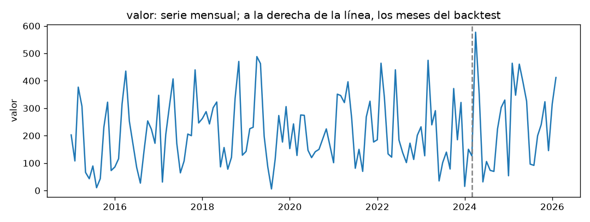
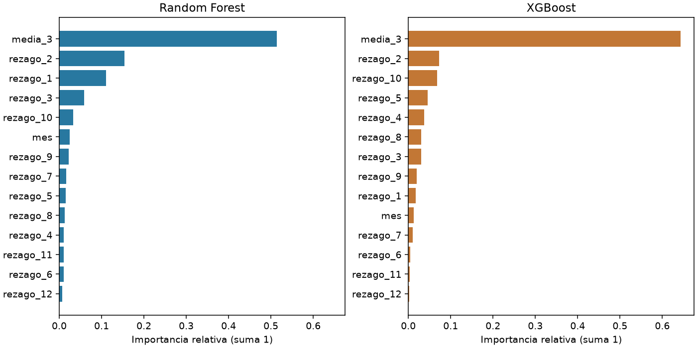
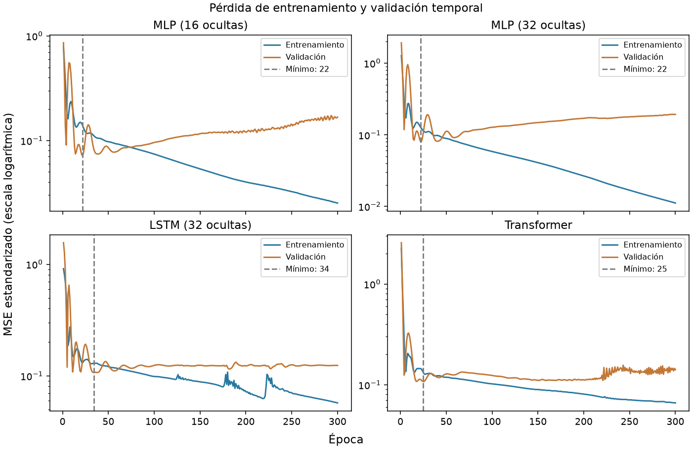
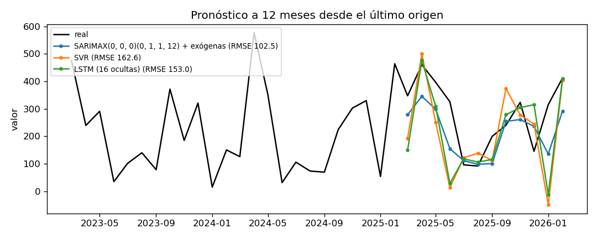

# Informe del miniproyecto 2

Llene cada sección reemplazando los marcadores `{{...}}`, sin quitar las
secciones. Las cifras salen de lo que imprime `python miniproyecto.py` y las
figuras son las que ese guion deja en `figuras/`. Las fórmulas van en LaTeX
(`$...$` o `$$...$$`).

## 1. La serie y el modelo a superar

La serie es la **lluvia mensual (mm)** de la estación **CDEA El Topacio**
(código 2629020601), en la cuenca del río Pance (Cali), suministrada por la
**CVC** para uso académico. Va de **enero de 2015 a febrero de 2026: 134
meses**. Se trae la decisión del miniproyecto 1: **no hay huecos** (ningún mes
quedó por debajo del 80 % de días con dato), y los **7 atípicos** del residuo
de una STL robusta (2022-02, 2022-05, 2022-06, 2023-03, 2023-10, 2024-04 y
2025-12) **se conservan**: son lluvia real o meses registrados con totales
diarios, un posible artefacto de medición que no se puede corregir sin otra
fuente. `preparar` lo comprueba con `assert` y los imprime.



El modelo a superar es el mejor del miniproyecto 1, un
**SARIMAX$(0,0,0)(0,1,1)_{12}$ con el número de días del mes** como exógena,
ajustado sobre la lluvia dividida por 100:

$$y_t - y_{t-12} = \beta\,(d_t - d_{t-12}) + \varepsilon_t + \Theta\,\varepsilon_{t-12},
\qquad \Theta = -0.860,\quad \beta = -100.9\ \text{mm por día},$$

con $d_t$ los días del mes $t$ (ajuste con toda la serie). Tiene **3
parámetros** ($\beta$, $\Theta$ y la varianza). Pronostica cada mes con un
patrón casi fijo, cercano al promedio de ese mes en los años anteriores. El
efecto de los días del mes sale de unos pocos febreros bisiestos, con signo
sin sentido físico y valor p 0.095: probablemente es casualidad, como se
concluyó en el miniproyecto 1.

| Modelo | RMSE | MAE | MAPE (%) |
|---|---|---|---|
| SARIMAX$(0,0,0)(0,1,1)_{12}$ + días del mes | **113.79** | **91.75** | 54.31 |
| Estacional ingenuo | 154.93 | 112.39 | **43.90** |

Las métricas **coinciden exactamente** con las del miniproyecto 1: mismo
*backtest* (13 orígenes, de 2024-02 a 2025-02, horizonte 1 a 12), misma
preparación y misma clase de statsmodels (`ARIMA`).

**El MAPE de 54 %.** En la sustentación del miniproyecto 1 se preguntó cómo
mejorarlo. Buena parte viene de la métrica: el MAPE divide por la lluvia real,
y en un mes seco un error pequeño en milímetros es enorme en porcentaje. Los
meses con menos de 100 mm son el 28 % de los pronósticos y aportan el 59 % del
MAPE; solo dos meses, **enero de 2025 (53.8 mm) y junio de 2024 (31.4 mm),
aportan el 50 %**. Por eso este trabajo decide por **RMSE**, y en la sección 5
se vuelve sobre la pregunta con todos los modelos.

## 2. La tabla supervisada

Cada mes $t$ es una fila con 14 columnas, todas calculadas con meses
anteriores a $t$:

| Columna | Fórmula | Qué aporta |
|---|---|---|
| `rezago_1` … `rezago_12` | $z_{t-k}$, $k = 1, \dots, 12$ | la lluvia de los doce meses anteriores; `rezago_12` es el mismo mes del año pasado |
| `mes` | el número del mes de $t$ (1 a 12) | la temporada: se conoce de antemano por el calendario |
| `media_3` | $\frac{1}{3}(z_{t-1} + z_{t-2} + z_{t-3})$ | si el trimestre reciente viene húmedo o seco |

**Qué aprenden los modelos: el nivel**, es decir, la lluvia del mes tal cual
($z_t = y_t$), no su diferencia con el mismo mes del año anterior. Se
decidió con los cuatro modelos en sus valores por defecto, en el mismo
*backtest*:

| Modelo | RMSE con el nivel | RMSE con la diferencia |
|---|---|---|
| Random Forest | **135.0** | 161.4 |
| XGBoost | **134.1** | 164.3 |
| KNN | **145.2** | 169.0 |
| SVR | 163.3 | **152.0** |

El nivel gana en tres de cuatro. La diferencia anual de la lluvia es casi
ruido: su única memoria clara es la del rezago 12 (la que captura el SARIMA),
y esa ya está en la tabla como columna. Con el nivel, además, la tabla tiene
**98 filas** antes del *backtest* (2016-01 a 2024-02) en lugar de 86, porque
no se pierde un año en la diferencia. Solo el SVR mejora con la diferencia, y
es porque así casi repite el año anterior: su RMSE (152.0) queda pegado al del
estacional ingenuo (154.9).

**La prueba de que no hay fuga.** `comprobar_sin_fuga` toma cada uno de los
134 meses, le suma 10 000 mm a su lluvia y vuelve a armar la tabla: la fila de
ese mes, que es lo que el modelo ve para pronosticarlo, tiene que quedar
idéntica. Si alguna columna cambia, lanza `AssertionError`. El guion imprime:

```
sin fuga: en los 134 meses, cambiar y(t) no cambia la fila de t (14 columnas: rezago_1, rezago_12, mes, media_3, ...)
```

La prueba sí detecta la fuga cuando existe: si la media móvil se calcula sin
el `shift(1)`, falla en la fila de 2015-03 y señala la columna `media_3`.

**El pronóstico recursivo.** Para pronosticar 12 meses desde un origen,
`recursivo` agrega el mes siguiente sin dato, arma su fila con la tabla,
pronostica, escribe el pronóstico como si fuera un dato y pasa al mes
siguiente. Desde el segundo mes, los rezagos más recientes son pronósticos,
no observaciones, así que los errores se acumulan con el horizonte.

**El escalador** vive dentro de cada modelo (KNN y SVR son `make_pipeline`
con `StandardScaler`; las redes escalan en `Red.fit`). Como `con_tabla` crea y
ajusta un modelo nuevo en cada origen con las filas de ese entrenamiento, la
media y la desviación salen solo de los meses anteriores al origen.

## 3. Aprendizaje automático

{{La rejilla de cada modelo, con qué datos y con qué validación temporal se
eligió, y los hiperparámetros elegidos con su RMSE de validación. Por qué
ninguno de los meses del *backtest* participa en la elección.}}



{{Qué variables pesan más en Random Forest y en XGBoost, y si coinciden con
los rezagos que marcaba la PACF en el miniproyecto 1.}}

{{RMSE, MAE y MAPE de los cuatro modelos y cuál gana entre ellos.}}

## 4. Aprendizaje profundo

{{Las tres redes: arquitectura, número de parámetros y cómo recibe cada una
la entrada (columnas sueltas o secuencia). Cuál es la tercera red y por qué
la eligió el grupo.}}



{{Lectura de las curvas: dónde empieza el sobreajuste, cuántas épocas se
eligieron para cada red y qué tamaño de MLP quedó.}}

{{La mejor red con cinco semillas: el RMSE de cada una, la media y la
desviación. Si la diferencia con el clásico es mayor o menor que esa
desviación.}}

## 5. La tabla y la elección

{{Copie aquí `resultados/metricas.csv` como tabla de Markdown, ordenada por
RMSE.}}

| Modelo | RMSE | MAE | MAPE (%) | Parámetros | Segundos |
|---|---|---|---|---|---|
| {{...}} | {{...}} | {{...}} | {{...}} | {{...}} | {{...}} |



{{Si alguna red no supera al clásico, a qué lo atribuye el grupo y qué dato
de la serie lo muestra: el número de meses frente al número de parámetros,
el mes en que falla, la curva de pérdida o la variación entre semillas.}}

## 6. Conclusión

{{El modelo que el grupo pondría en uso y lo que se paga por él frente al
clásico: cuántos datos necesita, cuánto tarda en el *backtest* y qué tanto
se puede explicar su pronóstico.}}
